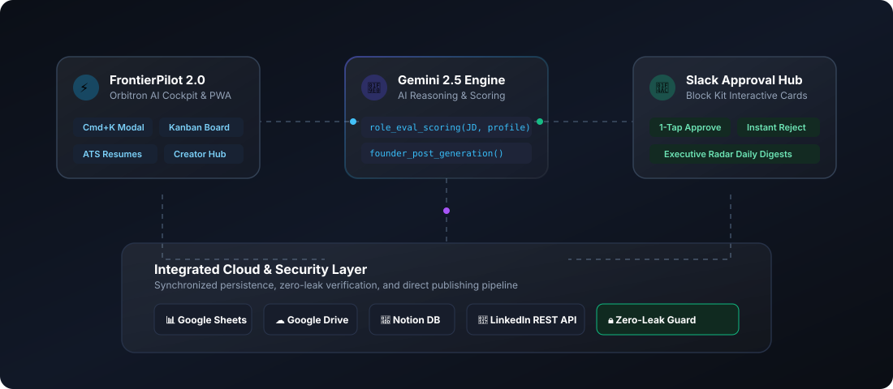

<p align="center">
  <a href="https://github.com/Aryansharma906/GetHired">
    
  </a>
</p>

<p align="center">
  <a href="https://github.com/Aryansharma906/GetHired"></a>
  <a href="https://github.com/Aryansharma906"></a>
  
  
  
  <a href="LICENSE"></a>
</p>

<p align="center">
  <b>Autonomous Career Intelligence, Real-Time Opportunity Radar, and LinkedIn Marketing Engine</b><br>
  <i>Built for high-agency engineers, founders, and autonomous AI agents.</i>
</p>

<p align="center">
  <a href="#-quickstart--local-setup"><b>⚡ Quickstart</b></a> •
  <a href="#-framer-style-feature-matrix"><b>✨ Features</b></a> •
  <a href="#-system-architecture"><b>🧠 Architecture</b></a> •
  <a href="#-the-12-linkedin-marketing-skills"><b>✍️ 12 AI Skills</b></a> •
  <a href="#-zero-leak-security-guard"><b>🛡️ Security Guard</b></a> •
  <a href="#-command-palette-shortcuts"><b>⌨️ Shortcuts</b></a>
</p>

---

## 🌟 Overview: What is getHired 2.0?

**getHired 2.0** is an enterprise-grade AI orchestration system created by **Aryan Sharma**. It bridges **career intelligence** with **thought-leadership publishing**:

1. **Autonomous Opportunity Radar**: Discovers high-leverage AI engineering roles, scores profile alignment using **Google Gemini 2.5 Flash**, diagnoses skill gaps, and tailors live ATS resumes and interview preparation dossiers.
2. **Interactive Slack Approval Hub**: Dispatches rich Block Kit approval cards directly to your mobile Slack channel—allowing you to review, approve, reject, or publish applications and LinkedIn drafts in 1 tap.
3. **12 Production AI Marketing Skills**: Autonomous Claude Code and Codex skills that draft viral LinkedIn posts using verified 2026 hook formulas, humanize AI copy to bypass slop detectors, and manage professional presence without human friction.
4. **Multi-Cloud Persistence**: Real-time two-way synchronization across **Google Sheets**, **Google Drive**, **Gmail**, **Notion**, and direct **LinkedIn REST API** connections.
5. **Zero-Leak Security Guard**: Built-in automated pre-commit and CI credential scanners that make it 100% safe to showcase in a public GitHub repository.

---

## ✨ Framer-Style Feature Matrix

<table>
  <tr>
    <td width="50%" valign="top">
      <h3>🎯 Autonomous Career Radar</h3>
      <p>Continuous monitoring of elite AI roles across frontier labs (Sarvam AI, Cohere, Scale AI, Cursor). Every role is scored against your master profile with gap analysis and match justification.</p>
      <ul>
        <li><b>Semantic Matching:</b> 0–100% conviction scoring via Gemini</li>
        <li><b>Progressive Notes Drawer:</b> Instant match breakdown per role</li>
        <li><b>1-Tap Cloud Sync:</b> Exports to Notion &amp; Google Sheets</li>
      </ul>
    </td>
    <td width="50%" valign="top">
      <h3>💬 1-Tap Slack Approval Hub</h3>
      <p>Zero requirement to open a computer terminal. Interactive Slack cards allow full editorial and career control from your mobile phone with real-time feedback.</p>
      <ul>
        <li><b>Approve &amp; Schedule:</b> 1-tap automated publishing</li>
        <li><b>Instant Reject:</b> Archive or defer low-conviction roles</li>
        <li><b>Executive Digest:</b> Daily scheduled 9:00 AM pipeline briefings</li>
      </ul>
    </td>
  </tr>
  <tr>
    <td width="50%" valign="top">
      <h3>📄 Dynamic ATS Resumes &amp; Prep</h3>
      <p>Generates tailored, ATS-optimized plain text and HTML resumes for every tracked opportunity without fabrication or hallucination.</p>
      <ul>
        <li><b>Live Tailoring:</b> Emphasizes real verified skills for each role</li>
        <li><b>Outreach Pitch Briefs:</b> Cold emails &amp; founder DM templates</li>
        <li><b>Interview Cheat-Sheets:</b> Technical Q&amp;A and architecture drills</li>
      </ul>
    </td>
    <td width="50%" valign="top">
      <h3>✍️ LinkedIn Creator Studio</h3>
      <p>A native thought-leadership workshop built directly into the getHired interface. Write, score, and repurpose career milestones into viral founder posts.</p>
      <ul>
        <li><b>2026 Hook Engine:</b> 20 proven high-engagement formulas</li>
        <li><b>Humanizer Guard:</b> Removes buzzwords and AI tells</li>
        <li><b>Repurposing:</b> Converts project milestones into posts</li>
      </ul>
    </td>
  </tr>
  <tr>
    <td width="50%" valign="top">
      <h3>☁️ 5-Way Multi-Cloud Sync</h3>
      <p>Bidirectional data pipelines connecting your career radar to everyday productivity platforms with automatic fallback to offline storage.</p>
      <ul>
        <li><b>Google Sheets:</b> Live tabular pipeline tracking</li>
        <li><b>Google Drive:</b> Automated application bundle storage</li>
        <li><b>Notion Database:</b> Kanban sync with live properties</li>
        <li><b>Direct LinkedIn REST:</b> Fast, latency-free publishing</li>
      </ul>
    </td>
    <td width="50%" valign="top">
      <h3>🔒 Zero-Leak Security Guard</h3>
      <p>Enterprise safety infrastructure ensuring no API keys, private tokens, or confidential data can ever be committed to the public repository.</p>
      <ul>
        <li><b>Local Pre-Commit Hook:</b> Rejects entropy secrets</li>
        <li><b>GitHub Actions Guard:</b> Continuous audit on every PR</li>
        <li><b>Strict Gitignore:</b> Blocks all environment variants</li>
      </ul>
    </td>
  </tr>
</table>

---

## 🧠 System Architecture

```
┌────────────────────────────────────────────────────────────────────────────────────────┐
│                                Aryan's AI Orchestration Hub                             │
│                                                                                        │
│   ┌────────────────────────┐      ┌───────────────────────┐     ┌───────────────────┐  │
│   │     getHired 2.0       │      │   Google Gemini 2.5   │     │   Slack Mobile    │  │
│   │    Career Radar PWA    │◄────►│     AI Brain & Evaluator   │◄───►│   Approval Hub    │  │
│   │  (Warm Ivory / PWA)    │      │  (2026 Hook Engine)   │     │  (Block Kit UI)   │  │
│   └───────────┬────────────┘      └───────────┬───────────┘     └─────────┬─────────┘  │
│               │                               │                           │            │
│               ▼                               ▼                           ▼            │
│   ┌─────────────────────────────────────────────────────────────────────────────────┐  │
│   │                      Unified Multi-Cloud Sync Pipeline                          │  │
│   │     Google Sheets   •   Google Drive   •   Notion DB   •   LinkedIn REST API    │  │
│   └─────────────────────────────────────────────────────────────────────────────────┘  │
│                                               ▲                                        │
│                                               │                                        │
│   ┌───────────────────────────────────────────┴─────────────────────────────────────┐  │
│   │                     Zero-Leak Automated Security Shield                         │  │
│   │      Local Git Hook Scanner   •   GitHub Actions CI Guard   •   Clean Manifests │  │
│   └─────────────────────────────────────────────────────────────────────────────────┘  │
└────────────────────────────────────────────────────────────────────────────────────────┘
```

<p align="center">
  
</p>

---

## ⚡ Quickstart & Local Setup

### 1. Clone & Install Dependencies

```bash
# Clone the canonical repository
git clone https://github.com/Aryansharma906/GetHired.git
cd GetHired

# Install Python requirements
pip install -r requirements.txt

# Install the pre-commit security guard
bash scripts/install_git_hooks.sh
```

### 2. Configure Environment (`.env`)

Create a `.env` file in the project root (automatically protected by the security guard):

```ini
# Google Gemini (for autonomous scoring and post generation)
GEMINI_API_KEY=AIzaSy_your_key_here

# Slack Webhook (for mobile interactive approval cards)
SLACK_WEBHOOK_URL=https://hooks.slack.com/services/T.../B.../...

# LinkedIn Direct API / Publora (Optional for publishing)
LINKEDIN_ACCESS_TOKEN=AQ...
PUBLORA_API_KEY=sk_...
LINKEDIN_PLATFORM_ID=linkedin-...
```

### 3. Launch the Studio

```bash
# Start the local server on http://127.0.0.1:5050
./scripts/start_studio.sh
```

Visit **`http://127.0.0.1:5050/gethired`** in your browser.

---

## ⌨️ Command Palette Shortcuts

getHired 2.0 features a keyboard-first navigation engine inspired by modern IDEs. Press `Cmd + K` (Mac) or `Ctrl + K` (Windows/Linux) from anywhere in the app:

| Shortcut | Action | Description |
|---|---|---|
| <kbd>Cmd</kbd> + <kbd>K</kbd> | **Open Command Palette** | Instant spotlight search across all opportunities, actions, and views |
| <kbd>G</kbd> <kbd>D</kbd> | **Go to Dashboard** | Career Radar overview, match statistics, and action queue |
| <kbd>G</kbd> <kbd>B</kbd> | **Go to Board** | Interactive Kanban funnel (Staged, Applied, Interviewing, Offered) |
| <kbd>G</kbd> <kbd>R</kbd> | **Go to Roles** | Filterable list of all 15 frontier opportunities with notes drawers |
| <kbd>G</kbd> <kbd>M</kbd> | **Go to Resumes** | ATS resume generator and document previewer |
| <kbd>G</kbd> <kbd>L</kbd> | **Go to Creator Studio** | LinkedIn thought-leadership writing and repurposing workbench |
| <kbd>E</kbd> | **Export JSON** | Instant client-side backup of all opportunities and notes |
| <kbd>S</kbd> | **Sync to Cloud** | Trigger immediate 5-way sync to Sheets, Drive, Notion, & Slack |

---

## ✍️ The 12 LinkedIn Marketing Skills

getHired bundles **12 production-grade AI skills** for Claude Code and Codex:

| Skill | Category | Capabilities & 2026 Standards |
|---|---|---|
| **Post Writer** | Content Engine | Drafts high-engagement posts using 20 proven 2026 hook formulas (anaphora, R.I.P. obituary, curiosity gap, false binary). |
| **Comment Drafter** | Engagement | Drafts high-signal, thoughtful comments on target LinkedIn posts from their URLs. |
| **Reply Handler** | Engagement | Handles LinkedIn's 2-level thread flattening; sweeps entire comment threads and drafts warm replies. |
| **Post Audit** | Quality Gate | Audits drafts against 2026 algorithm rules, paragraph density limits, and AI-detection patterns before posting. |
| **Humanizer** | Polish | Removes synthetic AI vocabulary ("leverage", "streamline", "delve"), eliminates stacked triads, and balances em dashes. |
| **Hook Extractor** | Research | Reverse-engineers the structural hook formula from any viral post and outputs an editable template. |
| **Content Planner** | Strategy | Generates 7-day founder content schedules with daily topics, formats, posting times, and target engagement profiles. |
| **Engagement Monitor** | Analytics | Tracks author reply windows (6–24h) and segments commenters by ICP fit (peer, prospect, partner). |
| **Profile Optimizer** | Branding | Rewrites headlines, About summaries, and Featured sections for 2026 inbound conversion patterns. |
| **Employee Advocacy** | Growth | Outlines a 14-day team advocacy launch, cadence, brand governance, and ROI metrics. |
| **Repurposer** | Cross-Platform | Transforms blogs, newsletters, or career achievements into native 900–1,300 char LinkedIn posts. |
| **Interviewer** | Story Bank | Conducts interactive interviews to extract authentic milestones, metrics, and turning points without hallucinations. |

---

## 🛡️ Zero-Leak Security Guard

This repository enforces strict, multi-tiered security guardrails so you can safely maintain and showcase the code publicly:

```
[ Developer Workflow ]
         │
         ▼
[ git commit ] ──────► [ .git/hooks/pre-commit ]
                              │
                              ├─► Check FORBIDDEN files (.env, *.key, credentials.json)
                              ├─► Scan High-Entropy Regexes (Gemini, Slack, OAuth, Tokens)
                              ▼
                     [ PASS / ABORT ]
                              │
                              ▼
[ git push ]   ──────► [ GitHub Actions CI Guard ]
                              │
                              └─► Automated check_no_secrets.py on every PR/Push
```

* **Local Verification**: Run `python3 scripts/check_no_secrets.py` at any time to verify that all 1,300+ tracked files are 100% clean of credentials.
* **Hook Re-installation**: Run `bash scripts/install_git_hooks.sh` to reinstall or verify the pre-commit gate.

---

## 📜 Voice & 2026 Writing Standards

All AI generation in getHired strictly adheres to human-first editorial guidelines:

1. **Em Dashes (`—`)**: Maximum 1 per 100 words (0–2 max per post).
2. **Strict Vocabulary Blacklist**: Never use *leverage, utilize, facilitate, streamline, robust, seamless, delve, navigate, unlock, harness, foster, cultivate, fundamentally, essentially, landscape, ecosystem, paradigm, game-changer*.
3. **Length**: Optimal range is **900–1,300 characters**.
4. **Mobile Readability**: 1–2 sentence paragraphs with whitespace.
5. **Authentic Receipts**: Every post is anchored to real engineering metrics and milestones.

---

## 📄 License & Attribution

Distributed under the **MIT License**.

```text
Copyright (c) 2026 Aryan Sharma <aryanaryan.9956@icloud.com>
Portions Copyright (c) 2026 Sergey Bulaev
```

See [`LICENSE`](LICENSE) for complete legal terms.

---

<p align="center">
  <b>Designed with high agency by <a href="https://github.com/Aryansharma906">Aryan Sharma</a></b><br>
  <sub>Autonomous AI Engineering • Career Intelligence • Thought Leadership</sub>
</p>
