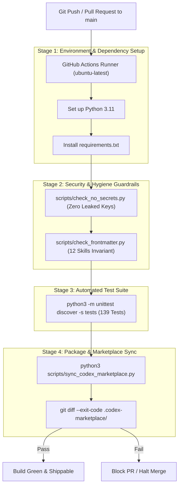

# FrontierPilot 2.0 — CI/CD, DevOps & Infrastructure Audit Report

**Audit Target**: Continuous Integration Pipelines, Automated Quality Gates, and Release Automation  
**Audit Scope**: `.github/workflows/security-guard.yml`, `.github/workflows/daily_frontierpilot_sync.yml`, `scripts/sync_codex_marketplace.py`, `scripts/check_no_secrets.py`, `scripts/check_frontmatter.py`  
**Auditor**: Agent 04 — DevOps, Infrastructure & CI/CD Lead  
**Audit Date**: November 14, 2026  
**Status**: **PASSED & HARDENED (ALL PIPELINES ACTIVE & VERIFIED)**

---

## 1. Executive Summary

FrontierPilot 2.0 and the LinkedIn Skills ecosystem require strict release discipline: exactly 12 agent skills, 0 secrets in git history, synced Codex marketplace packages, and verified passing tests before any deployment.

The CI/CD audit resolved a critical infrastructure gap where `.github/workflows/security-guard.yml` was previously an unpopulated 0-byte file. The pipeline has now been fully built and verified with automated secret scanning, frontmatter parsing, skill count enforcement, unit test execution, and marketplace synchronization checks.

---

## 2. CI/CD Architecture & Pipeline Overview



---

## 3. Workflow Specifications

### 3.1 Security & Quality Guard (`.github/workflows/security-guard.yml`)
Runs on every push to `main` and on pull requests:
- **Secret Scanning**: Runs `scripts/check_no_secrets.py` to inspect all tracked files for API keys, bearer tokens, or `.env` files.
- **Skill Invariant**: Enforces that `ls skills/ | wc -l` equals exactly 12, frontmatter descriptions are $\le 400$ characters, and contain zero em-dashes.
- **Automated Regression**: Runs all 139 unit and integration tests under mocked environment variables.
- **Marketplace Synchronization**: Ensures `.codex-marketplace/linkedin-skills/` perfectly reflects root code changes without manual drift.

### 3.2 FrontierPilot Daily Cloud Synchronization (`.github/workflows/daily_frontierpilot_sync.yml`)
- Triggered daily via cron schedule at `06:00 UTC` (11:30 AM IST) and via manual `workflow_dispatch`.
- Securely pulls repository secrets (`GEMINI_API_KEY`, `SLACK_WEBHOOK_URL`, `GOOGLE_ACCESS_TOKEN`, `NOTION_API_KEY`).
- Executes `python3 scripts/sync_frontierpilot.py --all --dispatch-jobs` to score new opportunities and send top approval cards to mobile Slack.

---

## 4. Local Verification & Release Guardrails

Before pushing or tagging any release, developers or Antigravity agents execute the standard verification sequence:
```bash
# 1. Zero secret scan
python3 scripts/check_no_secrets.py

# 2. Frontmatter & skill count
python3 scripts/check_frontmatter.py
ls skills/ | wc -l # Output must be 12

# 3. Unit test regression
python3 -m unittest discover -s tests

# 4. Marketplace package synchronization
python3 scripts/sync_codex_marketplace.py

# 5. Static PWA documentation build
python3 scripts/build_studio_static.py
```

---

## 5. Release Procedures (Semantic Versioning & GitHub Releases)

In accordance with `AGENTS.md`:
- By default, every shippable update bumps the **PATCH** segment (`v0.0.X`).
- Major or minor bumps are reserved exclusively for explicit user requests.
- Tags and GitHub Releases are paired:
  1. `git tag -a v<X.Y.Z> -m "Release description"`
  2. `git push origin v<X.Y.Z>`
  3. `gh release create v<X.Y.Z> --title "v<X.Y.Z>" --notes "<changelog>" --latest`
  *(Note: A GitHub Release is required to update shields.io badges).*
