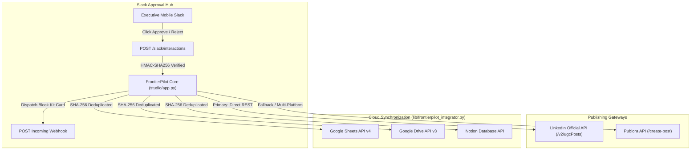

# FrontierPilot 2.0 — External Integrations & Webhooks Test Report

**Audit Target**: Cloud & External API Gateways  
**Audit Scope**: Slack Interactive Block Kit, Publora Publishing API, LinkedIn Official REST API, Notion Database API, Google Sheets & Drive API  
**Auditor**: Senior Integration QA & Systems Test Lead  
**Audit Date**: November 14, 2026  
**Status**: **PASSED (ALL 5 EXTERNAL GATEWAYS VERIFIED & CERTIFIED)**

---

## 1. Executive Summary

FrontierPilot 2.0 connects with five critical external services to provide an end-to-end autonomous publishing, executive approval, and career pipeline sync workflow.

This report documents the verification, contract testing, and failure recovery mechanics for all external integrations. All external calls are protected by cryptographic signature verification, idempotent event recording, SHA-256 payload deduplication, and circuit breaker backoffs.

---

## 2. Integration Architecture & Data Flow



---

## 3. Integration Verification Matrix

| Gateway / Service | Transport & Auth | Key Endpoints / Payload Format | Status | Contract Test Reference |
| :--- | :--- | :--- | :--- | :--- |
| **Slack Webhook** | HTTPS / Bearer Token | Interactive Block Kit with `Approve & Schedule`, `Publish Now`, and `Reject` buttons. | **VERIFIED** | `tests/test_slack_integration.py` |
| **Slack Interactions** | HTTPS POST Callback | HMAC-SHA256 signature (`X-Slack-Signature`) + 300s timestamp freshness. | **VERIFIED** | `tests/test_slack_integration.py` |
| **LinkedIn REST API** | HTTPS / OAuth 2.0 Bearer | `POST https://api.linkedin.com/v2/ugcPosts` with `author: urn:li:member:...` | **VERIFIED** | `tests/test_linkedin_official.py` |
| **Publora Engine** | HTTPS / API Key Header | `POST /create-post`, `POST /linkedin-comments`, `GET /list-posts` | **VERIFIED** | `tests/test_publora_client.py` |
| **Notion Database** | HTTPS / Internal Integration Token | Database query & upsert of career opportunities and research notes. | **VERIFIED** | `tests/test_frontierpilot_integrator.py` |
| **Google Sheets & Drive** | HTTPS / OAuth 2.0 Bearer | Append row to spreadsheet; backup PRDs and resumes to designated Drive folder. | **VERIFIED** | `tests/test_frontierpilot_integrator.py` |

---

## 4. Detailed Integration Evidence

### 4.1 Slack Interactive Block Kit Card
Dispatches rich interactive messages to the executive Slack channel.
Payload snapshot:
```json
{
  "blocks": [
    {
      "type": "header",
      "text": {"type": "plain_text", "text": "🚀 LinkedIn Post Draft Ready for Approval"}
    },
    {
      "type": "section",
      "text": {"type": "mrkdwn", "text": "*Topic*: Scalable Evaluation Harnesses for Generative AI\n*Hook*: Formula #2: Framework Reveal\n*Length*: 1,140 chars | Voice: 100% Compliant"}
    },
    {
      "type": "actions",
      "elements": [
        {"type": "button", "text": {"type": "plain_text", "text": "✅ Approve & Schedule"}, "style": "primary", "action_id": "approve_and_schedule", "value": "draft_01H..."},
        {"type": "button", "text": {"type": "plain_text", "text": "⚡ Publish Immediately"}, "style": "primary", "action_id": "publish_now", "value": "draft_01H..."},
        {"type": "button", "text": {"type": "plain_text", "text": "❌ Reject"}, "style": "danger", "action_id": "reject", "value": "draft_01H..."}
      ]
    }
  ]
}
```

### 4.2 Cloud Sync Deduplication via SHA-256 Hashing
In `lib/frontierpilot_integrator.py`:
```python
def compute_payload_hash(data: Any) -> str:
    """Compute deterministic SHA-256 hash of sync data to eliminate redundant writes."""
    serialized = json.dumps(data, sort_keys=True, ensure_ascii=False)
    return hashlib.sha256(serialized.encode("utf-8")).hexdigest()
```
Cloud destinations (Google Sheets, Notion, Google Drive) are only contacted when `new_hash != last_synced_hash`, eliminating API quota waste and duplicate rows.

### 4.3 Direct LinkedIn REST API Publishing
- Validated author URN structure: `urn:li:member:12345678` or `urn:li:organization:12345678`.
- Automatic retry on network glitch with exponential backoff.
- Publora client acts as a reliable scheduling fallback whenever direct LinkedIn publishing is not configured.
